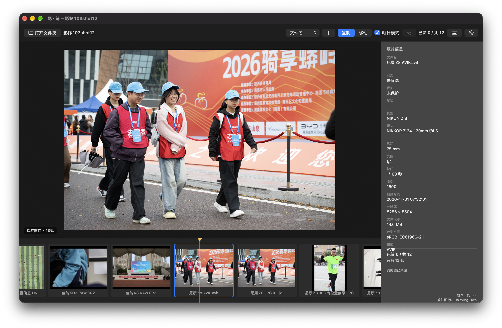
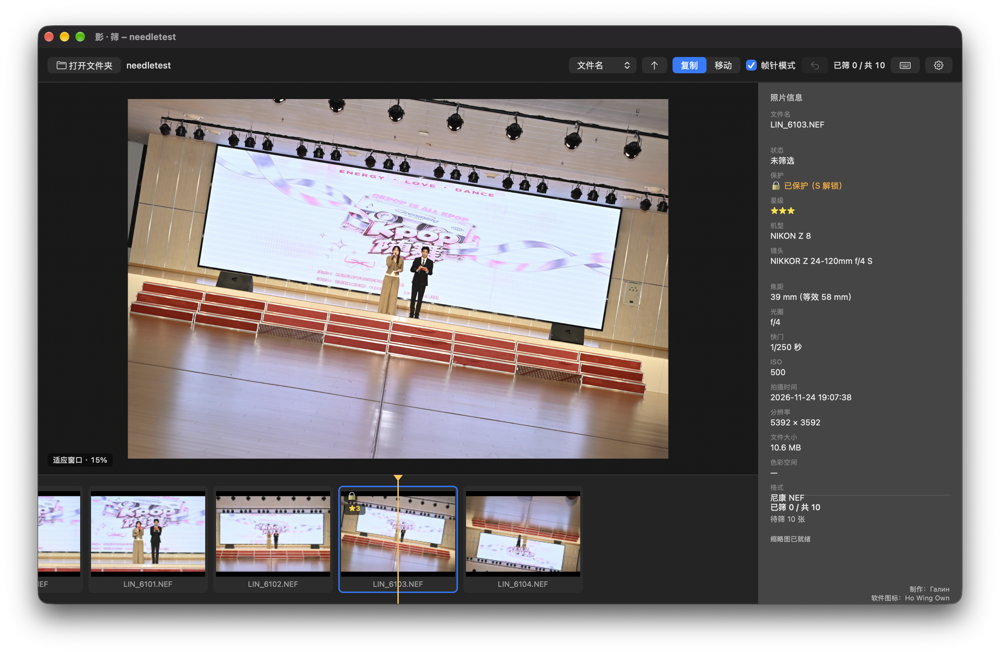
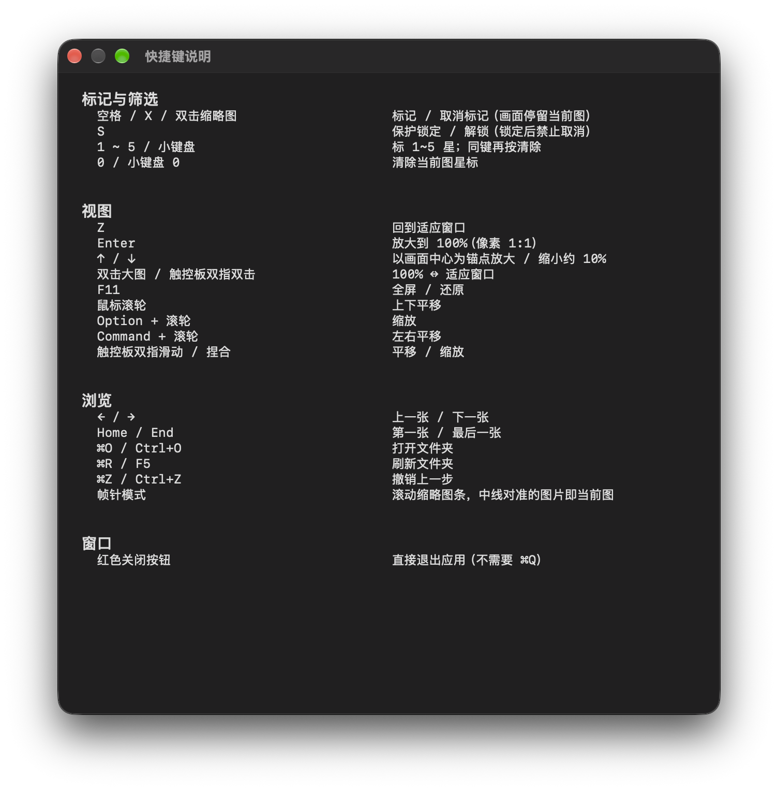

# 影·筛 / PhotoCull

> **Windows + macOS 双平台，为“一次拍几千张、只想赶紧挑出能用的”而生。**
> 打开文件夹，看一眼，按空格；满意的照片自动复制进「筛选」文件夹。原文件永远不动。

[](https://github.com/Jadis038/PhotoCull/releases/tag/v1.0.8)
[](https://github.com/Jadis038/PhotoCull/releases/tag/macos-v1.0.3)
[](LICENSE)
[](#下载)

**作者：Галин** ｜ **软件图标：Ho Wing Own** ｜ **开发：Галин 与 DeepSeek / GLM 系列 AI 协作**

---

## 下载

本仓库的 Release **只保留每个平台的最新版安装包**，旧安装包已清理。

| 平台 | 最新版本 | 安装包 | 系统要求 |
|---|---|---|---|
| **Windows** | **v1.0.8** | [PhotoCull-Setup-1.0.8.msi](https://github.com/Jadis038/PhotoCull/releases/download/v1.0.8/PhotoCull-Setup-1.0.8.msi) | Windows 10 21H2+ / Windows 11，x64 |
| **macOS** | **1.0.3** | [PhotoCull-1.0.3-macOS-arm64.dmg](https://github.com/Jadis038/PhotoCull/releases/download/macos-v1.0.3/PhotoCull-1.0.3-macOS-arm64.dmg) | macOS 12+，Apple Silicon（M1/M2/M3/M4…） |

- Windows 安装包约 57 MB，macOS 安装包约 1.9 MB。
- 发布页：[Windows v1.0.8](https://github.com/Jadis038/PhotoCull/releases/tag/v1.0.8) ｜ [macOS 1.0.3](https://github.com/Jadis038/PhotoCull/releases/tag/macos-v1.0.3)
- 源码：[Windows/通用 `src/`](src/) ｜ [macOS `macos/`](macos/)

---

## 它解决什么问题

一次拍摄 2000~3000 张 RAW，逐张放大、判断、把满意的挑出来，是摄影后期最耗时的环节。影·筛只做一件事：

**看到满意的照片，按空格 / X / 双击缩略图，把它复制到当前文件夹下的「筛选」子文件夹，并保留原文件。**

- 不需要先多选、不需要暂存区、不需要最后统一执行
- 连点 10 张 = 10 次独立操作，各自成功或失败
- 取消勾选 = 把「筛选」里的副本移入回收站 / 废纸篓，**原文件永远不会被动**
- 随时撤销；重启后自动核对副本是否还在

---

## 功能一览

### 双端共有

- **打开方式**：按钮选文件夹、拖拽文件/文件夹进窗口、系统「打开方式」
- **第一层扫描**：只列当前文件夹的图片，不递归、排除隐藏文件和「筛选」目录
- **自然排序**：`IMG_2 < IMG_10`；可按文件名 / 拍摄时间 / 修改时间 / 文件大小排序
- **大图查看**：适应窗口、100%、滚轮/捏合缩放、拖拽平移、双击切换
- **横向缩略图条**：虚拟化只渲染可见项；已标记项绿勾 + 降饱和
- **帧针模式**：工具栏默认开启；滚动缩略图条，中线对准的图片成为当前图（macOS 1.0.3 的指针固定在中线，见下文）
- **标记**：空格 / X / 双击缩略图；默认复制，可切移动
- **保护锁定（S）**：锁定的照片不会被取消筛选，也不会被撤销取消
- **星级（0–5）**：数字键标星，状态持久化
- **撤销**：撤销复制 / 取消 / 移动
- **自动更新**：启动时检查 GitHub，发现新版本由用户决定是否下载安装
- **快捷键说明**：工具栏按钮 / 帮助菜单
- **红色关闭按钮直接退出**：不需要再按 ⌘Q / Alt+F4
- **署名**：制作：Галин / 软件图标：Ho Wing Own

### macOS 1.0.3 重点

- **帧针固定在缩略图条正中**，不再为首尾贴图；两侧动态留白让第一张、最后一张也能居中
- **普通鼠标滚轮每滚一格切相邻一张**（向下下一张、向上一张）；触控板仍可连续滚动
- Enter 100%、Z 适应窗口、↑/↓ 以画面中心缩放 10%、F11 全屏
- 原生缩放百分比：以原图全分辨率为基准；预览图切原图只变清晰，尺寸、中心、平移不变（2%–1200%）
- 色彩空间直读：EXIF/TIFF 40961、DNG AsShotProfileName；没有则显示「—」，不猜
- 启动切 ABC 英文输入法；工具栏快捷键说明窗口
- 保护 / 星级状态存 SQLite，重启保留；缩略图显示 🔒 / ★n

### Windows v1.0.8 重点

- Enter 放大到 100%、Z 适配窗口、0 清除星标、↑↓ 固定中心缩放、F11 全屏
- S 保护锁定、数字标星、快捷键说明窗口
- 修复 Nikon Z8 100% 花屏；全量缩略图预热提速
- 自包含 .NET 发布，每用户安装，免管理员权限

---

## 界面







---

## 使用说明（双端）

### 1. 打开照片

- 点左上角「打开文件夹」，选一个照片文件夹；
- 或者直接把文件夹拖进窗口；
- 或者在文件资源管理器 / 访达里右键某张照片 → 打开方式 → 影·筛 / PhotoCull。

### 2. 标记与取消

- **空格 / X / 双击缩略图**：标记 / 取消当前图，画面停留当前图（空格不再翻页）。
- 已经打勾的图再操作一次 = 取消，副本进入回收站 / 废纸篓，原文件不动。
- 连点多张互不影响；队列在后台逐张处理。
- 顶部可切换「复制」或「移动」模式。

### 3. 帧针模式

- 工具栏「帧针模式」默认开启；向下滚动缩略图条时，中线对准的图就是当前图，大图、信息栏、计数同步。
- **macOS 1.0.3**：帧针固定在中线；鼠标滚轮一格切相邻一张；首尾靠两侧动态留白居中。
- **Windows**：滚动缩略图条由帧针判定当前图；具体边界行为以 Windows 1.0.8 界面为准。
- 关闭帧针后，缩略图条恢复普通滚动/单击选择。

### 4. 大图与缩放

| 操作 | 方式 |
|---|---|
| 适应窗口 | `Z`（macOS 也支持菜单 ⌘0；Windows 也支持 Ctrl+0） |
| 100% 原图 | `Enter` |
| 放大 / 缩小 | `↑` / `↓`，以画面中心为锚点约 10% |
| 双击大图 / 双指双击 | 100% ↔ 适应窗口（macOS 以双击点为锚） |
| 鼠标滚轮 | 上下平移 |
| 缩放 | macOS `Option + 滚轮`；Windows `Alt + 滚轮` |
| 左右平移 | macOS `Command + 滚轮`；Windows `Ctrl + 滚轮` |
| 触控板 | 双指滑动平移，捏合缩放；双指双击切换 100% / 适应 |
| 左键拖拽 | 放大后平移 |

> 缩放百分比按**原图全分辨率**显示。从预览图切到全尺寸原图时只提升清晰度，画面不跳、不偏移。

### 5. 保护与星级

- **S**：保护 / 解锁当前图。锁定后，空格 / X / 双击缩略图 / 右键「取消筛选」都会被拒绝，并提示先按 S 解锁；撤销也不会取消受保护副本。
- **1–5**：标 1–5 星；再按同一个数字清除；**0** 清除当前图星标（含小键盘）。
- 保护 / 星级会持久化，重启应用后保留。
- macOS 信息栏显示「🔒 已保护（S 解锁）」与金色 ★；缩略图左上角显示 🔒 / ★n。

### 6. 撤销与移动

- 复制 / 取消 / 移动都可以撤销；撤销栈有上限，空栈时按钮禁用。
- 移动模式下，原文件会被移进「筛选」；取消时移回原位，同名冲突自动改名，不覆盖。
- 每条记录记住自己是用复制还是移动产生的，中途切换模式不会误处理旧记录。

### 7. 快捷键总表

| 操作 | 快捷键 |
|---|---|
| 上一张 / 下一张 | `←` / `→` |
| 第一张 / 最后一张 | `Home` / `End` |
| 标记 / 取消当前图 | `空格` / `X` / 双击缩略图 |
| 保护 / 解锁 | `S` |
| 星级 | `1–5`；同键再按清除；`0` 清除 |
| 适应窗口 | `Z` |
| 100% 原图 | `Enter` |
| 中心放大 / 缩小 10% | `↑` / `↓` |
| 全屏 / 还原 | `F11` |
| 撤销 | macOS `⌘Z` / `Ctrl+Z`；Windows `Ctrl+Z` |
| 打开文件夹 | macOS `⌘O` / `Ctrl+O`；Windows `Ctrl+O` |
| 刷新 | macOS `⌘R` / `F5`；Windows `Ctrl+R` / `F5` |
| 快捷键说明 | 工具栏【快捷键】/【键盘】按钮，或帮助菜单 |
| 退出 | macOS 点红色关闭按钮（或 ⌘Q）；Windows 关闭窗口（或 Alt+F4） |

---

## 安装

### Windows

1. 下载 `PhotoCull-Setup-1.0.8.msi`，双击安装。
2. 每用户安装到 `%LOCALAPPDATA%\Programs\影·筛`，**免管理员权限**；静默安装：
   ```powershell
   msiexec /i PhotoCull-Setup-1.0.8.msi /qn
   ```
3. 若 SmartScreen 提示“未知发布者”，点「更多信息 → 仍要运行」。
4. 卸载不会删除照片、`筛选` 文件夹、索引或缓存。

### macOS

1. 下载 `PhotoCull-1.0.3-macOS-arm64.dmg`，把「影·筛」拖进「应用程序」。
2. 第一次打开若提示“无法验证开发者”，在终端执行：
   ```bash
   xattr -cr "/Applications/影·筛.app"
   ```
   然后正常双击；也可以右键 → 打开 → 仍要打开。
3. 首次访问桌面 / 文档 / 下载目录时，macOS 会询问文件夹访问权限，点「允许」。
4. 应用需要放在「应用程序」等可写目录，自动更新才能替换自身。

---

## 自动更新

- **Windows v1.0.8**：启动时检查 GitHub Releases，有新版本弹窗；用户同意后下载 MSI 并安装。
- **macOS 1.0.3**：通过 GitHub Releases Atom 源检查 `macos-` 标签；下载 DMG → 替换 `.app` → 重启。直连失败自动走 `gh-proxy.com` 镜像。
- 两端都可在设置里关闭“启动时检查更新”。
- 手动检查：
  ```bash
  # Windows
  影·筛.exe --update-check
  # macOS
  "/Applications/影·筛.app/Contents/MacOS/影·筛" --update-check
  ```

---

## 数据安全与隐私

- **原目录文件永不删除**：标记默认复制；取消只处理「筛选」里的副本，进入回收站 / 废纸篓。
- **不覆盖同名文件**：冲突自动加 `(1)`；先写 `.part` 再原子改名；失败回滚。
- **本地存储**：
  - Windows：`%LOCALAPPDATA%\影·筛\`（cache / state / logs）
  - macOS：`~/Library/Application Support/影·筛/`（cache / state / logs）
- **不上传照片或路径**。唯一网络访问是检查更新和用户同意后的更新包下载。
- 重要操作前仍建议保留备份；软件按“现状”提供，不对数据丢失承担责任。

---

## 支持格式

**RAW（实机测试）**：Nikon NEF/NRW、Canon CR2/CR3、Sony ARW、Fujifilm RAF、Olympus ORF、Panasonic RW2、Pentax PEF、Samsung SRW、Hasselblad 3FR、Leica M（DNG）、Mamiya/Leaf MEF/MOS、Kodak/Minolta/Epson DCR/MRW/ERF、DJI DNG、Apple/Google/Samsung/小米/华为/OPPO/OnePlus/realme/HTC/LG/Ricoh 等手机 DNG。

**普通图片**：JPG/JPEG、PNG、TIFF、WebP、BMP、HEIC/HEIF、AVIF、JXL（部分依赖系统图像扩展）。

**明确不支持**：Sigma/Polaroid X3F（Foveon 专有）、三星专有压缩 DNG（`Compression=52546`）等无公开解码方案的格式；会显示占位/无法解码，不影响其他文件。

---

## 常见问题

**1. 双击没反应？**  
请确认双击的是下方缩略图。大图双击是 100% / 适应窗口切换。

**2. 为什么显示的色彩空间是「—」？**  
Nikon NEF 等 RAW 通常不写 EXIF/TIFF 40961，也没有 DNG AsShotProfileName。macOS 1.0.3 按“不猜”的原则显示「—」；JPEG/HEIC/AVIF 会显示实际 ICC。

**3. 按了红色按钮，应用直接退出了？**  
这是特意设计的：macOS 点红色关闭按钮就是退出应用，不需要再按 ⌘Q。

**4. 为什么缩略图有点糊？**  
RAW 缩略图优先使用相机内嵌小预览以换取速度；上方大图加载 2048px 预览，按 Enter 或放大超过阈值会后台加载完整原图。

**5. 更新失败？**  
macOS 需要把应用放在「应用程序」等可写目录；Windows 更新需要能写入当前用户安装目录。网络失败会自动尝试镜像。

**6. 想换图标 / 换名字？**  
源码与构建脚本都在仓库中，可自行修改后重新构建。

---

## 从源码构建

### Windows

需要 .NET SDK 与 WiX v4：

```powershell
dotnet build src\YingShai.App\YingShai.App.csproj -c Release
# 生成 MSI（自包含发布 + WiX 打包）
Get-Content installer\build.ps1 -Raw -Encoding UTF8 | Invoke-Expression
```

### macOS

需要 macOS 12+、Xcode Command Line Tools（无需完整 Xcode）：

```bash
cd macos
./build.sh
open 影·筛.app
```

---

## 项目结构

```text
src/                 Windows .NET 应用与 Core 引擎
installer/           WiX MSI 打包
macos/               macOS 原生 Swift + AppKit 版
  Sources/           Swift 源码
  docs/              SPEC、验收报告、格式矩阵、性能
  build.sh           构建 .app
docs/                Windows 设计/验收/性能资料
latest.json          Windows 更新兜底元数据
```

---

## 许可与署名

- 主代码：**MIT License**（见 [LICENSE](LICENSE)）。
- Windows RAW 解码使用 [LibRaw](https://www.libraw.org/)（LGPL-2.1 / CDDL-1.0 双许可，动态链接，未修改源码）；完整声明见 `native/libraw/THIRD-PARTY-NOTICES.txt`。
- macOS 使用系统 ImageIO，无第三方 RAW 运行时。
- 软件图标：**Ho Wing Own（YSLGOG）**，版权归原作者。
- 作者 / Author：**Галин**；开发协作：Галин 与 DeepSeek / GLM 系列 AI。

> 本仓库提及的 Nikon、Canon、Sony、Fujifilm、Olympus、Panasonic、Pentax、Leica、Hasselblad、DJI、Samsung、Apple、Microsoft 等品牌与商标归各自权利人所有；提及仅用于说明兼容性，无隶属或背书关系。
