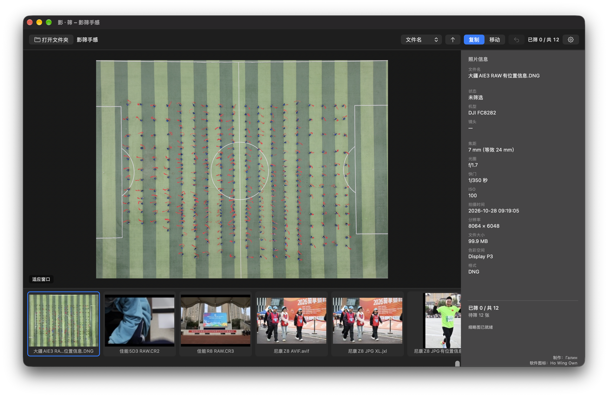
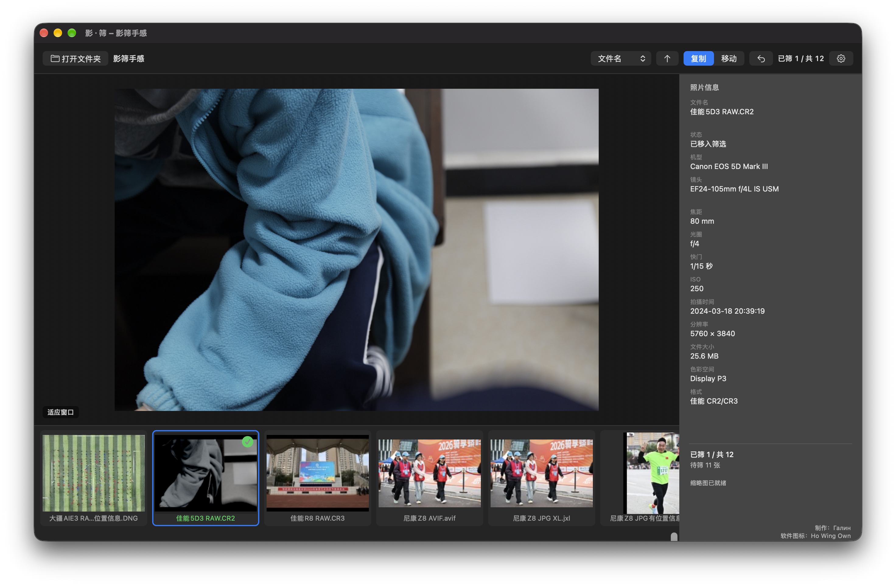
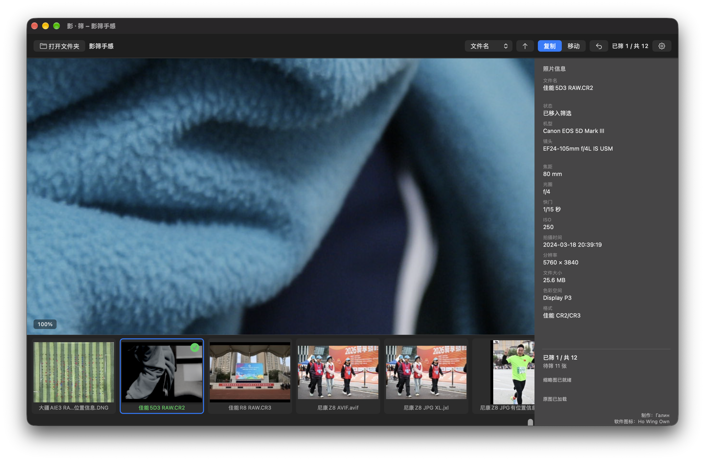
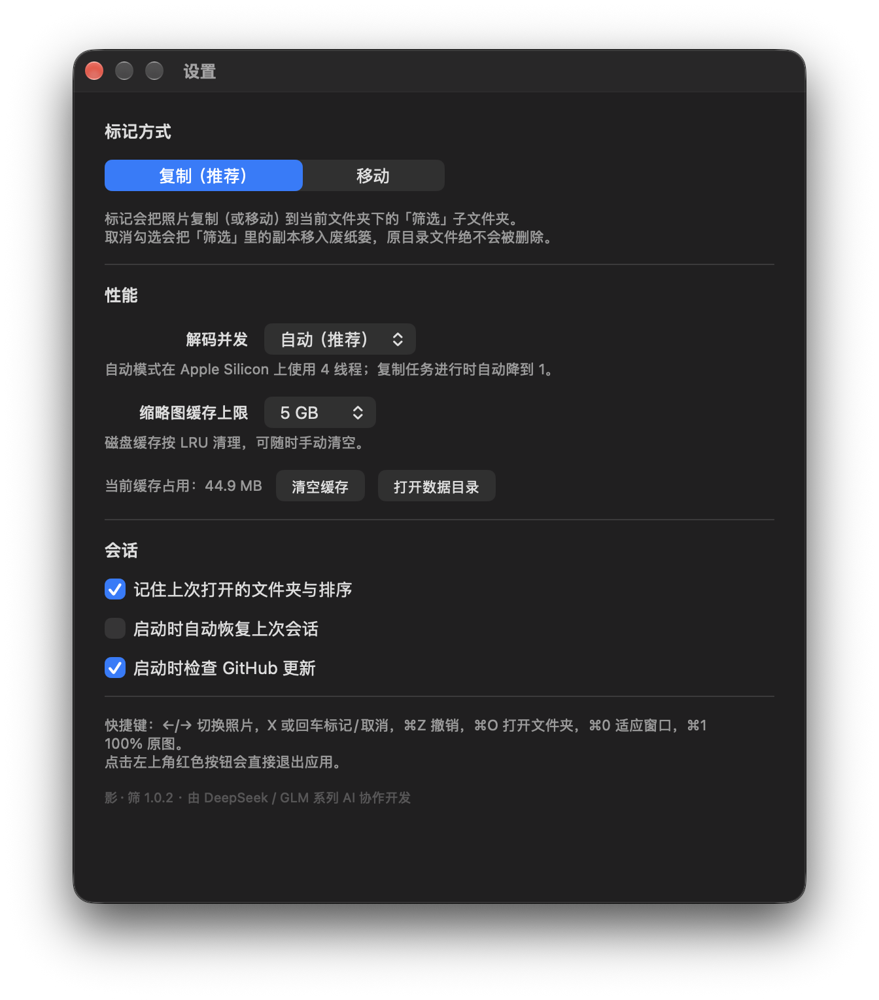
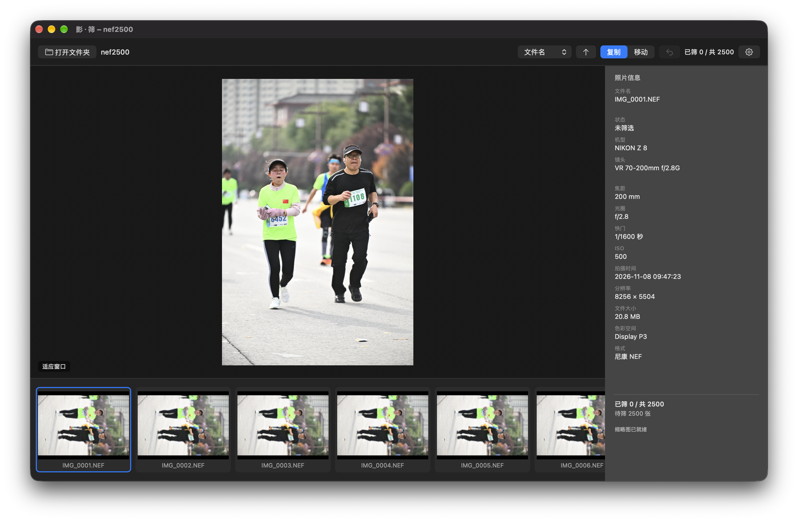

# 影·筛 / PhotoCull（macOS 版）

**极快的照片筛选工具：双击标记，立刻把照片复制到「筛选」文件夹；原目录文件永不被删除。**

原生 Swift + AppKit 应用，完全开源（MIT），专为 Apple Silicon 优化。

- 作者：**Галин**
- 图标：**Ho Wing Own（YSLGOG）**
- 开发：**Галин 与 DeepSeek / GLM 系列 AI 协作完成**
- 主代码许可：**MIT**（见 [LICENSE](LICENSE)）
- 移植自 [Windows 版 PhotoCull](https://github.com/Jadis038/PhotoCull) 的完整需求（本仓库尚未上传 GitHub，按用户要求暂不发布）

---

## 平台与兼容性

| 项目 | 说明 |
|---|---|
| 芯片 | Apple Silicon（arm64，M1/M2/M3/M4 及以后） |
| 系统 | macOS 12 Monterey 及以上；已在 **macOS 27.2.1** 实测，覆盖 macOS 26/27 与后续版本 |
| 构建 | 仅需 Xcode Command Line Tools，无需完整 Xcode；SwiftPM |
| 运行时 | 无第三方运行时依赖（不需要 .NET / Electron / Homebrew / LibRaw） |

> 用户需求中提到的 “macOS 16” 并不存在（Apple 从 macOS 15 直接跳到 macOS 26）。本应用把最低系统设为 macOS 12，因此任何比它新的版本（包括 26、27 以及未来版本）都能运行。

---

## 它解决什么问题

一次拍摄 2000+ 张 RAW，逐张放大、判断、把满意的挑出来，是摄影后期最耗时的环节。影·筛只做一件事：

**双击（或按 X / 回车）把这一张复制到当前文件夹下的「筛选」子文件夹，并保留原文件。**

- 不需要先多选、不需要暂存区、不需要最后统一执行
- 连点 10 张 = 10 次独立操作，各自成功或失败
- 取消勾选 = 把「筛选」里的副本移入废纸篓，原文件永远不会被动
- 随时 ⌘Z 撤销

### 主要功能

- **三种打开方式**：按钮选文件夹、拖拽文件/文件夹进窗口、访达「打开方式」
- **第一层扫描**：只列当前文件夹的图片（不递归、排除隐藏文件/临时文件/筛选目录）
- **自然排序**：`IMG_2 < IMG_10`；可切换拍摄时间 / 修改时间 / 文件大小，升降序
- **大图查看**：适应窗口 / 100% 原图 / 滚轮缩放 / 拖拽平移 / 双击恢复适应窗口；自动应用 EXIF 方向
- **横向缩略图条**：虚拟化，只渲染可见项；已标记项绿勾 + 降饱和；位置永不重排；鼠标滚轮上下 = 左右滚动；选中不会强制把缩略图拉到最左边
- **信息栏**：机型、镜头、焦距、光圈、快门、ISO、拍摄时间、分辨率、文件大小、色彩空间、格式
- **标记**：双击缩略图 / X / 回车；默认复制，可切移动；伴生文件（.xmp/.aae/.thm、同名 JPG/HEIF）一起处理
- **安全**：先写 `.part` 再原子改名；同名自动 `(1)` 不覆盖；失败回滚；取消清理 `.part`
- **取消**：副本进废纸篓（可恢复）；每条记录记住自己是用复制还是移动产生的
- **撤销**：⌘Z，撤销栈 2000 步（复制 / 取消 / 移动都可撤销）
- **状态索引**：SQLite（WAL），按文件夹哈希分库；启动时校验副本是否存在，失效时按文件名重建
- **复制/移动队列**：单写线程、先进先出、可取消、不阻塞预览
- **单实例**：从访达「打开方式」打开第二张图片会复用已有窗口，不会开第二个应用
- **红色按钮直接退出**：点窗口左上角红叉 = 退出应用，不需要 ⌘Q（这是明确需求）
- **右下角署名**：制作：Галин / 软件图标：Ho Wing Own

---

## 界面预览











---

## 1.0.2 修复

- 连续双击大图时，第二次“双击”不再需要等待：系统会把连击计数累加到 3/4，现在按偶数次点击切换 100% / 适应窗口
- 修复触控板斜向平移时上下轴反向的问题（左右轴保持正向）；鼠标滚轮方向保持不变
- 触控板 Option+滚动缩放方向与手指方向保持一致

## 1.0.1 交互改进

- 触控板：双指滑动 = 平移，双指捏合 = 缩放；双指双击 = 100% / 适应窗口切换
- 鼠标：滚轮上下平移，Option + 滚轮缩放，Command + 滚轮左右平移
- 大图双击：第一次 100%，再次回到适应窗口
- 缩略图栏：鼠标滚轮上下 = 左右滚动；选中缩略图不再强制滚动到最左边，保留当前位置
- 信息栏右下角增加“制作：Галин / 软件图标：Ho Wing Own”

## 自动更新

- 每次启动（可在设置中关闭）检查 GitHub Releases 里**只针对 macOS** 的 `.dmg` 更新。
- Windows 的 MSI Release 会被忽略；为避免影响 Windows 端的“最新版本”判断，macOS 的 Release 以 **prerelease** 形式发布。
- 发现新版本会弹窗显示版本号与更新说明，由用户选择「下载并安装」或「以后再说」。
- 下载完成后校验版本号，替换当前 `.app` 并自动重启；应用需要放在「应用程序」等可写目录。
- 手动检查：`"影·筛.app/Contents/MacOS/影·筛" --update-check`

## 安装与运行

### 直接使用

1. 打开 `影·筛-1.0.2-macOS-arm64.dmg`，把「影·筛」拖进「应用程序」。
2. 第一次打开若提示“无法验证开发者”，在终端执行：
   ```bash
   xattr -cr "/Applications/影·筛.app"
   ```
   然后正常双击。也可以右键 → 打开 → 仍要打开。
3. 打开应用 → 点「打开文件夹」选择照片目录，或把文件夹拖进窗口。

> 首次访问桌面 / 文档 / 下载目录时，macOS 会弹出“想访问…文件夹中的文件”，点「允许」即可。

### 从源码构建

```bash
cd PhotoCull-macOS
./build.sh            # 生成 影·筛.app
open 影·筛.app
```

要求 macOS 12+、已安装 Xcode Command Line Tools（`xcode-select --install`）。构建脚本会用 SwiftPM 编译，再组装 `.app`、拷贝图标与文档、做临时签名（ad-hoc）。没有 Xcode 也可以。

### 自检与基准（无需打开界面）

```bash
# 引擎自检：扫描、自然排序、复制、冲突改名、取消、移动、撤销、索引重建
"影·筛.app/Contents/MacOS/影·筛" --selftest

# 真实文件夹性能基准，输出 CSV
"影·筛.app/Contents/MacOS/影·筛" --bench "/你的/照片目录" --limit 2000 --csv ~/Desktop/bench.csv

# 格式矩阵：逐个文件验证能否打开
"影·筛.app/Contents/MacOS/影·筛" --matrix "/你的/照片目录" --csv ~/Desktop/matrix.csv

# 界面级自动化验收（会短暂打开窗口）
"影·筛.app/Contents/MacOS/影·筛" --uitest "/你的/照片目录"
```

---

## 快捷键

| 操作 | 快捷键 |
|---|---|
| 上一张 / 下一张 | ← / → |
| 标记 / 取消当前照片 | X 或 回车 |
| 双击缩略图 | 标记 / 取消 |
| 撤销上一步 | ⌘Z |
| 打开文件夹 | ⌘O |
| 刷新文件夹 | ⌘R |
| 适应窗口 | ⌘0 |
| 100% 原图 | ⌘1 |
| 放大 / 缩小 | ⌘= / ⌘- |
| 触控板双指捏合 | 缩放（以光标位置为中心） |
| 触控板双指滑动 | 向各方向平移图片 |
| 鼠标滚轮 | 上下平移图片 |
| Option + 鼠标滚轮 | 缩放（以光标位置为中心） |
| Command + 鼠标滚轮 | 左右平移图片 |
| 拖拽大图 | 平移（100% 或放大后） |
| 双击大图 / 触控板双指双击 | 在 100% 与适应窗口之间切换 |
| 退出 | 点红色关闭按钮（或 ⌘Q） |

---

## 数据与隐私

| 内容 | 位置 |
|---|---|
| 状态索引（每个文件夹一个 SQLite） | `~/Library/Application Support/影·筛/state/` |
| 缩略图磁盘缓存 | `~/Library/Application Support/影·筛/cache/` |
| 设置 | macOS `UserDefaults`（`com.jadis038.photocull`） |
| 日志 | `~/Library/Application Support/影·筛/photocull.log` |

- 应用**不联网**，不上传任何照片或信息。
- 「标记」只复制（或移动）到当前图片目录下的 `筛选/`，不会删除原文件。
- 「取消标记」只处理 `筛选/` 里的副本，进入废纸篓，可恢复。
- 卸载应用不会删除缓存与索引；如需清理，在设置里「清空缓存」或手动删除上述目录。

---

## 性能（真实实测）

测试环境：macOS 27.2.1，Apple Silicon，内置 SSD；使用真实样本目录。

### 2500 张尼康 Z8 NEF（8256×5504，单张约 20.8 MB）

| 指标 | 实测 | 目标 |
|---|---|---|
| 枚举 2500 个文件 | 142 ms | < 1.0 s |
| 首屏 20 张缩略图 | **6 ms** | < 2.0 s |
| 2000 张缩略图（4 线程） | **244 ms** | < 3 分钟 |
| 单张缩略图 P50 / P95 | **0.5 / 0.7 ms** | < 400 ms |
| 2048 大图预览 P50 / P95 | 66.6 / 68.4 ms | — |
| 100% 全解（含方向）P50 | 236 ms | < 3 s |
| 内存采样峰值（基准进程） | 102 MB | < 1.2 GB |
| 实际界面 2500 张常驻内存 | 约 233 MB | < 1.2 GB |

> 关键：RAW 缩略图不启动 RAW 解码管线，而是直接解析 TIFF/BMFF 容器里的相机内嵌 JPEG（NEF 单张约 0.5 ms）。缩略图只求快，画质让位；大图仍走高质量解码。

### 2000 张 JPG（单张约 5 MB，目录共 8573 张）

| 指标 | 实测 |
|---|---|
| 枚举 8573 个文件 | 640 ms |
| 首屏 20 张缩略图 | 5 ms |
| 2000 张缩略图 | 194 ms |
| 2048 预览 P50 | 58.4 ms |
| 100% 全解 P50 | 142 ms |
| 内存峰值 | 118 MB |

### 52 个混合格式样本（CR2/CR3/NEF/ARW/RAF/ORF/RW2/DNG/HEIC/AVIF/JXL/EXR/PNG/TIFF…）

| 指标 | 实测 |
|---|---|
| 首屏 20 张 | 711 ms（含 239 MB PNG、EXR、AVIF 等慢格式） |
| 缩略图 P50 / P95 | 15.5 ms / 173.4 ms |
| 2048 预览 P50 / P95 | 68.6 ms / 432.2 ms |
| 100% 全解 P50 / P95 | 66 ms / 883 ms |
| 界面常驻内存（预热完成） | 约 160 MB |
| 全部 52 个格式 | 50/52 可打开（2 个 X3F 为 Foveon 专有格式，系统 ImageIO 不支持） |

完整 CSV 见 [docs/bench/](docs/bench/)。

---

## 支持格式

- **RAW**：NEF、CR2、CR3、ARW、RAF、ORF、RW2、PEF、DNG、SRW、ERF、MEF、MOS、MRW、DCR、3FR 等（由 macOS ImageIO 系统 RAW 管线支持；是否支持取决于系统 RAW 版本）
- **普通图片**：JPG、PNG、TIFF、BMP、GIF、WebP、HEIC/HEIF、AVIF、JPEG XL（JXL）、OpenEXR（EXR）
- 不支持：Sigma / Polaroid 的 **X3F**（Foveon 专有格式，系统无解码器）
- 已知限制：Mamiya ZD 的 `.MEF` 在 ImageIO 中只暴露一张 144×192 的内嵌小图

### 与 Windows 版的技术差异

Windows 版使用 .NET/WPF + LibRaw。macOS 版改用 **原生 Swift + AppKit + ImageIO**：

- 无 .NET 运行时依赖，冷启动快、安装包小；
- 相机 RAW 由系统 RAW 管线解码，无需随包分发 LibRaw（因此没有 LGPL/CDDL 打包义务）；
- 缩略图走自研的 TIFF/BMFF 内嵌 JPEG 抽取器，比系统 RAW 解码快 1~2 个数量级；
- 大图预览 2048px、100% 由系统管线输出全尺寸（优先使用相机内嵌全尺寸 JPEG），画质优先。

---

## 目录结构

```
PhotoCull-macOS/
├── Sources/PhotoCull/          # 全部 Swift 源码
│   ├── main.swift              # 入口 / CLI
│   ├── AppDelegate.swift       # 应用、菜单、单实例
│   ├── MainWindowController.swift
│   ├── ImageCanvasView.swift   # 大图缩放/平移
│   ├── ThumbnailStrip.swift    # 横向虚拟化缩略图条
│   ├── InfoSidebarView.swift
│   ├── SettingsWindowController.swift
│   ├── ViewerSession.swift     # 会话/排序/选择/状态
│   ├── Scanner.swift           # 第一层扫描/自然排序
│   ├── Metadata.swift          # EXIF/TIFF 元数据
│   ├── FastThumbnail.swift     # RAW 内嵌 JPEG 快速缩略图
│   ├── ImagePipeline.swift     # 解码/三级缓存/优先级调度
│   ├── MarkEngine.swift        # 复制/移动/取消/回收站/撤销
│   ├── Database.swift          # SQLite 状态索引 + 缓存索引
│   ├── SelfTest.swift          # --selftest
│   ├── Bench.swift             # --bench
│   ├── FormatMatrix.swift      # --matrix
│   └── UITest.swift            # --uitest
├── Resources/                  # 图标（YSLGOG 生成）
├── docs/                       # SPEC、验收报告、测试矩阵、bench CSV
├── Info.plist
├── build.sh
├── LICENSE
├── THIRD-PARTY-NOTICES.txt
├── 使用说明.md
└── README.md
```

---

## 开源协议与致谢

- 主代码：**MIT**，见 [LICENSE](LICENSE)。
- 图标：**Ho Wing Own（YSLGOG）**，版权归原作者；本仓库按作者要求用于「影·筛」。
- 界面图标：Apple SF Symbols（随系统使用）。
- 图像解码：Apple ImageIO / CoreGraphics / CoreImage 系统框架，无第三方二进制随包。
- 开发协作：**DeepSeek / GLM 系列 AI** 与作者共同完成；所有验收均为真实文件、真实基准、可复跑命令。

详见 [THIRD-PARTY-NOTICES.txt](THIRD-PARTY-NOTICES.txt)、[docs/SPEC.md](docs/SPEC.md)、[docs/验收报告.md](docs/验收报告.md)。

## 法律声明

本软件按“现状”提供，不附带任何明示或暗示担保。筛选操作涉及文件复制/移动，请自行保留重要照片的备份。应用不会删除原目录文件；取消筛选仅把「筛选」副本移入废纸篓。各相机品牌与格式名称归其权利人所有，本项目与它们无隶属或背书关系。
